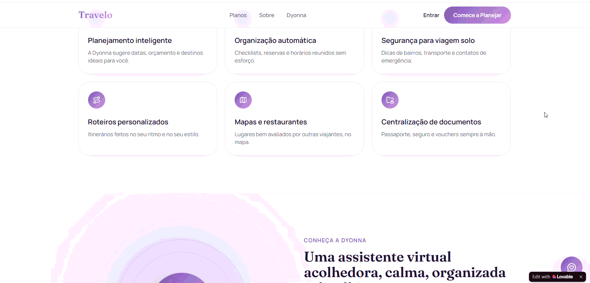
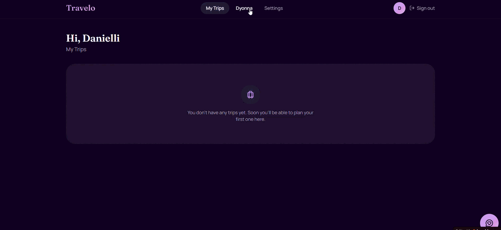
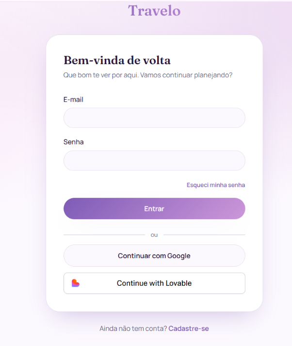
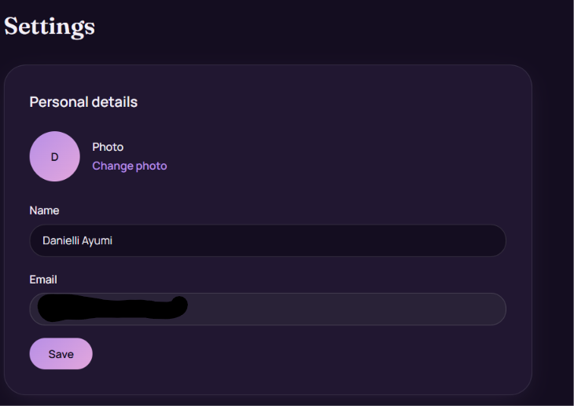
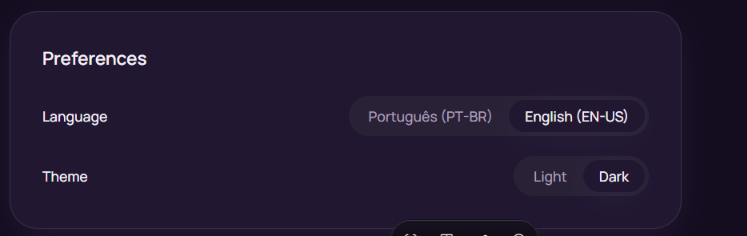

# Travelo: Vibe Coded App for Solo Female Travelers with Lovable

[🇧🇷 Português](README.md) | README_EN.md

---

assets/hero-mockup.jpg

## About the Project

Travelo is a digital platform designed for women who want to travel alone with greater safety, autonomy, and organization.

The platform aims to centralize every stage of the travel journey into a single environment, providing tools for trip planning, document organization, itinerary management, map visualization, destination recommendations, and support through a specialized virtual assistant.

The platform's main differentiator is the virtual assistant **Dyonna**, an AI-powered solution designed to act as a digital travel companion, helping users from the initial planning stage through the execution of their trip.

---

## Problem

Millions of women travel alone or aspire to begin this type of experience. However, several factors make the process challenging, including:

- Safety concerns during trip planning;
- Excessive information spread across multiple platforms;
- Difficulty organizing documents and itineraries;
- Lack of personalized support during the trip;
- The need to consult several applications to complete travel planning.

---

## Solution

Travelo integrates the essential components of travel planning into a single platform:

- Intelligent trip planning;
- Daily itinerary management;
- Centralized storage for documents and vouchers;
- Map integration;
- Restaurants and places catalog;
- Specialized virtual assistant;
- Responsive web platform;
- Mobile-friendly experience.

---

## Functional Architecture

### Landing Page

The landing page is designed to present:

- Travelo's value proposition;
- The Dyonna virtual assistant;
- Platform benefits;
- Freemium and Premium plans;
- User onboarding and trip-planning conversion.

---

### Dyonna Virtual Assistant

Dyonna is a virtual assistant specialized in solo female travel.

Features:

- Welcoming communication style;
- Calm tone of voice;
- Professional language;
- Detailed responses;
- Focus on safety and organization.

---

### My Trips Area

The application's main workspace consists of:

#### Overview

Trip monitoring table containing:

- Days;
- Cities;
- Accommodations;
- Transportation;
- Status.

#### Daily Itinerary

Day-by-day trip organization.

Each day may include:

- Activities;
- Accommodations;
- Documents;
- Vouchers;
- Notes.

#### Maps

Google Maps integration for:

- Locations;
- Routes;
- Points of interest.

#### Restaurants & Places

Management and organization of:

- Restaurants;
- Cafés;
- Attractions;
- Tourist destinations.

---

## Technologies Used

### Development

- React
- TypeScript
- Tailwind CSS

### Backend & Database

- Supabase

### Artificial Intelligence

- Microsoft Copilot
- Large Language Models (LLMs)

### Development Platform

- Lovable

### Methodology

- Prompt Engineering
- AI-Assisted Development

---

## Prompt Structure

The prompts were organized incrementally to minimize rework and allow continuous evolution of the application.

| Prompt | Description | File |
|----------|------------|----------|
| Prompt 0 | Global project definition, architecture, and cumulative guidelines | ./PROMPTS_INICIAIS/prompt_mestre.md |
| Prompt 1 | Construction of the Travelo institutional landing page | ./PROMPTS_INICIAIS/PROMPT1_Landing_Page.md |
| Prompt 2 | Authentication implementation and initial navigation structure | ./PROMPTS_INICIAIS/PROMPT2_Autenticação.md |
| Prompt 3 | Implementation of the Dyonna virtual assistant | ./PROMPTS_INICIAIS/PROMPT3_chatbot.md |
| Prompt 4 | Development of the main "My Trips" area | ./PROMPTS_INICIAIS/PROMPT4_Minhas_Viagens.md |
| Prompt 5 | Final integrations, Supabase, Google Maps, and functional MVP | ./PROMPTS_INICIAIS/PROMPT5_ajustes_finais.md |

---

## Academic Objective

This project was developed as a practical study covering:

- Software Engineering;
- Digital Product Design;
- Business Modeling;
- Prompt Engineering;
- AI-Assisted Development;
- MVP Development using No-Code and Low-Code tools.

---

## Project Status

In development.

Current version: MVP

---

# Initial Results

## Landing Page

---

## Chatbot (Dyonna) and User Area

---

## Login and Registration

## User settings area

