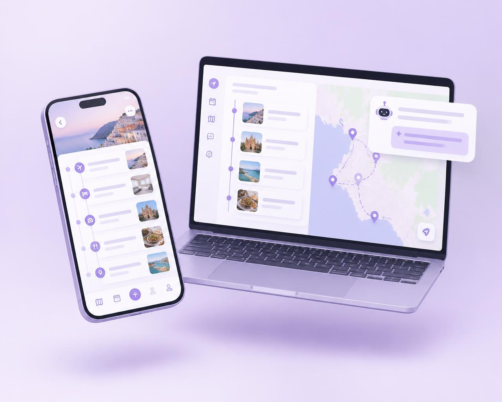
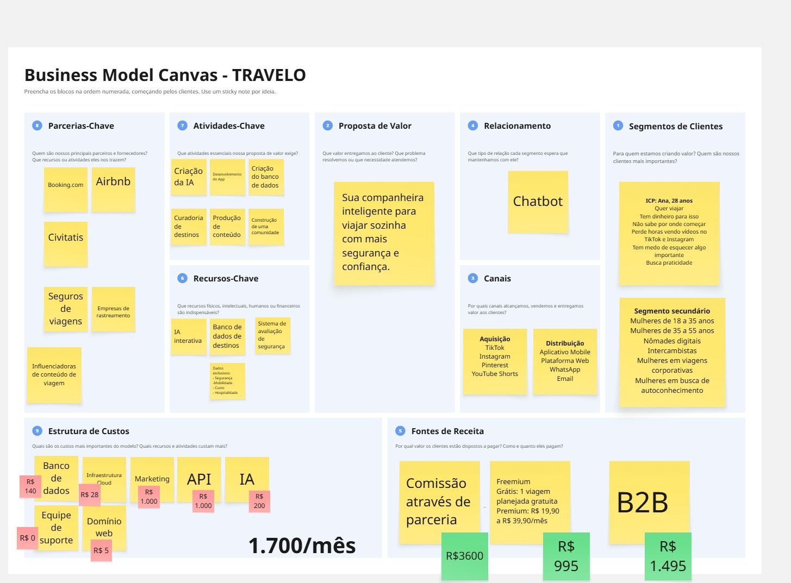
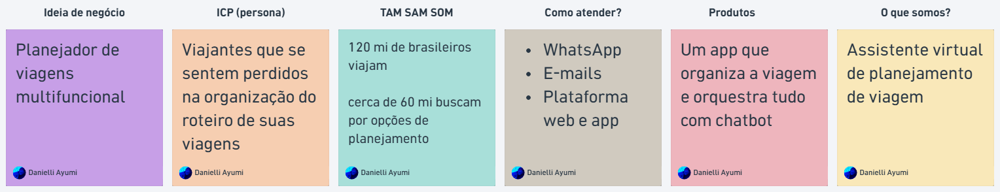

# Travelo : Vibe Coded app for Solo Female Travelers with Lovable

[🇺🇸 English](PROMPTS_ENGLISH/README.en.md)
 
---

## Sobre o Projeto

Travelo é uma plataforma digital voltada para mulheres que desejam viajar sozinhas com mais segurança, autonomia e organização.

A proposta da plataforma é centralizar todas as etapas da jornada de viagem em um único ambiente, oferecendo recursos para planejamento, organização documental, gerenciamento de roteiros, visualização de mapas, recomendação de locais e suporte por meio de uma assistente virtual especializada.

O principal diferencial da solução está na utilização da assistente virtual **Dyonna**, uma IA projetada para atuar como uma companheira digital de viagem, auxiliando usuárias desde o planejamento inicial até a execução da viagem.

---

## Problema

Milhões de mulheres realizam viagens sozinhas ou desejam iniciar esse tipo de experiência. Entretanto, diversos fatores dificultam esse processo, incluindo:

- Insegurança durante o planejamento;
- Excesso de informações dispersas entre diferentes plataformas;
- Dificuldade para organizar documentos e itinerários;
- Falta de suporte personalizado durante a viagem;
- Necessidade de consultar múltiplos aplicativos para concluir o planejamento.

---

## Solução

Travelo integra os principais elementos necessários para uma viagem em uma única plataforma:

- Planejamento inteligente de viagens;
- Organização diária do roteiro;
- Centralização de documentos e vouchers;
- Integração com mapas;
- Catálogo de lugares e restaurantes;
- Assistente virtual especializada;
- Plataforma web responsiva;
- Aplicação adaptada para dispositivos móveis.

---

## Modelo de Negócio

### Business Model Canvas

---

### Proposta de Negócio

---

## Arquitetura Funcional

### Landing Page

A landing page tem como objetivo apresentar:

- A proposta de valor da Travelo;
- A assistente virtual Dyonna;
- Benefícios da plataforma;
- Planos Freemium e Premium;
- Conversão para cadastro e planejamento de viagens.

---

### Assistente Virtual Dyonna

A Dyonna é uma assistente virtual especializada em viagens solo femininas.

Características:

- Comunicação acolhedora;
- Tom calmo;
- Linguagem profissional;
- Respostas detalhadas;
- Foco em segurança e organização.

---

### Área "Minhas Viagens"

A área principal da aplicação é composta por:

#### Overview

Tabela de acompanhamento da viagem contendo:

- Dias;
- Cidades;
- Hospedagens;
- Transportes;
- Status.

#### Roteiro Diário

Organização da viagem por dia.

Cada dia pode conter:

- Passeios;
- Hospedagens;
- Documentos;
- Vouchers;
- Observações.

#### Mapas

Integração com Google Maps para:

- Localização;
- Rotas;
- Pontos de interesse.

#### Restaurantes e Lugares

Cadastro e gerenciamento de:

- Restaurantes;
- Cafés;
- Atrações;
- Pontos turísticos.

---

## Tecnologias Utilizadas

### Desenvolvimento

- React
- TypeScript
- Tailwind CSS

### Backend e Banco de Dados

- Supabase

### Inteligência Artificial

- Microsoft Copilot
- Large Language Models (LLMs)

### Plataforma de Desenvolvimento

- Lovable

### Metodologia

- Prompt Engineering
- Desenvolvimento Orientado por IA (AI-Assisted Development)

---

## Estrutura dos Prompts

Os prompts foram organizados de forma incremental para minimizar retrabalho e permitir evolução contínua da aplicação.

| Prompt | Descrição | Arquivo |
|----------|------------|----------|
| Prompt 0 | Definição global do projeto, arquitetura e diretrizes cumulativas | [prompt_mestre.md](./PROMPTS_INICIAIS/prompt_mestre.md) |
| Prompt 1 | Construção da Landing Page institucional da Travelo | [PROMPT1_Landing%20Page.md](./PROMPTS_INICIAIS/PROMPT1_Landing_Page.md) |
| Prompt 2 | Implementação de autenticação e estrutura inicial de navegação | [PROMPT2_Autenticação.md](./PROMPTS_INICIAIS/PROMPT2_Autenticação.md) |
| Prompt 3 | Implementação da assistente virtual Dyonna | [PROMPT3_chatbot.md](./PROMPTS_INICIAIS/PROMPT3_chatbot.md) |
| Prompt 4 | Desenvolvimento da área principal "Minhas Viagens" | [PROMPT4_Minhas_Viagens.md](./PROMPTS_INICIAIS/PROMPT4_Minhas_Viagens.md) |
| Prompt 5 | Integrações finais, Supabase, Google Maps e MVP funcional | [PROMPT5_ajustes_finais.md](./PROMPTS_INICIAIS/PROMPT5_ajustes_finais.md) |

---

## Objetivo Acadêmico

Este projeto foi desenvolvido como estudo prático de:

- Engenharia de Software;
- Design de Produto Digital;
- Modelagem de Negócio;
- Prompt Engineering;
- Desenvolvimento Assistido por Inteligência Artificial;
- Construção de MVPs com ferramentas No-Code e Low-Code.

---

## Status do Projeto

Em desenvolvimento.

Versão atual: MVP

---

# Resultados iniciais:

## Landing Page

## Chatbot (Dyonna) e user area

## Login ou Cadastro

## User settings 

